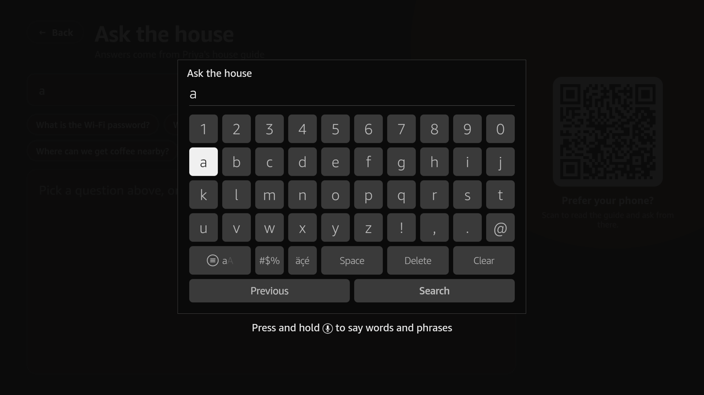
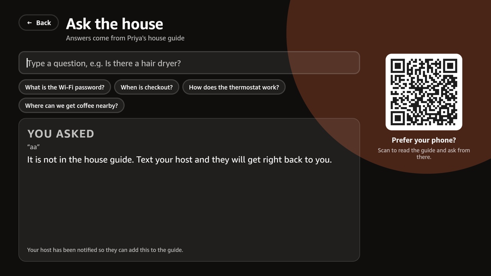

# Stayboard

**Your rental's welcome screen, on the Fire TV. Guests ask the TV; you answer once.**

Stayboard is a Fire TV app built on **Vega OS** for short-term rentals. The host configures everything on a website: Wi-Fi, check-in and checkout, house rules, a house guide, FAQs, local picks, contacts, colors and tiles. The TV shows it the moment it turns on. Guests can **ask the TV anything** and get an answer grounded in the host's own content via **Amazon Bedrock (Nova 2 Lite)**. Questions the guide can't answer land in the host's inbox as a one-click FAQ, so the next guest gets an instant answer.

Built for the Amazon "Build, Ship, Shape" Developer Hackathon 2026, Fire TV track (also the AWS Builder and Open Source mini-challenges).

- Live dashboard: https://stayboard.kalashshah47.workers.dev
- Friction log: [docs/friction-log.md](docs/friction-log.md)
- Design spec: [docs/superpowers/specs/2026-10-14-stayboard-design.md](docs/superpowers/specs/2026-10-14-stayboard-design.md)

## Why

Welcome-screen apps already exist on Fire TV (Hello Guest Screen, WelcomeScreen, Breezee). They show static information and charge $7–15 a month. Stayboard is free, open source, built on Amazon's new Vega OS, and adds the part hosts actually spend their evenings on: answering the same questions over and over. The TV answers from the house guide; the host only ever fills a gap once.

## What's in the box

| Part | Where | Stack |
|---|---|---|
| Fire TV app | `tv/` | React Native 0.83 for Vega (`@amazon-devices/react-native-kepler` 4), QR codes, AsyncStorage |
| API + database | `worker/`, `migrations/` | Cloudflare Worker (Hono), D1 (SQLite), Amazon Bedrock Nova 2 Lite via `aws4fetch` |
| Host dashboard | `src/` | React 19 + Vite, live 16:9 preview of the TV screen, autosave |
| Guest phone page | `src/pages/Guest.tsx` | Same SPA at `/g/<slug>`, reached from a QR code on the TV |

### TV screens

Pair → Home (welcome with the guest's name, clock, tiles) → Wi-Fi (password + scannable QR) → Checkout (times + checklist) → House rules → House guide (topics + FAQs) → Local picks → Contacts → **Ask the house** (suggested questions, on-screen keyboard, answer card, QR to ask from a phone).

All screens are D-pad navigable with visible focus rings and work with the remote's Back button. The TV polls for config every 60 s (every 5 s while unpaired) and keeps the last config in storage so a reboot while offline still shows the screen.

### How "Ask the house" stays honest

The Worker builds a system prompt from the property config (stay, Wi-Fi, rules, guide, FAQs, places, contacts) and asks Nova 2 Lite to answer **only** from it, returning `{"answered": bool, "answer": string}`. Unanswered questions get a short "not in the guide" reply plus the host's fallback line, and show up in the inbox. Temperature 0, 300 max tokens, a 300-call global daily cap and 60 per guest page per day. No guest identity is sent to the model.

## Run it yourself

Prerequisites: Node 20+, a Cloudflare account, an AWS account with Bedrock access to `us.amazon.nova-2-lite-v1:0` in us-east-1, and (for the TV) the Vega SDK on a Mac or Linux machine.

```bash
# API + dashboard
npm install
npx wrangler d1 create stayboard            # put the id in wrangler.jsonc
npx wrangler d1 migrations apply stayboard --remote
cp .dev.vars.example .dev.vars              # AWS_ACCESS_KEY_ID / AWS_SECRET_ACCESS_KEY (IAM user with bedrock:InvokeModel only)
                                            # GOOGLE_CLIENT_ID / GOOGLE_CLIENT_SECRET (OAuth web client; redirect URI <origin>/api/auth/google/callback)
npx wrangler secret bulk .dev.vars
npm run deploy                              # vite build + wrangler deploy
npm test                                    # vitest: config schema, hashing, prompt, answer parsing

# TV app (Vega SDK installed: curl -fsSL https://sdk-installer.vega.labcollab.net/get_vvm.sh | bash)
cd tv && npm install
# point tv/src/api.ts API_BASE at your Worker URL, then:
npm run build:release
vega virtual-device start
vega run-app build/aarch64-release/stayboard_aarch64.vpkg com.kalashshah.stayboard.main -d VirtualDevice
```

For a real Fire TV Stick running Vega OS: enable developer mode, `vega device install-app --packagePath build/armv7-release/stayboard_armv7.vpkg`, then `vega device launch-app --appName com.kalashshah.stayboard.main`.

## For judges (no Fire TV needed)

1. Open https://stayboard.kalashshah47.workers.dev and create an account (Continue with Google, or any email and a password of 8+ characters).
2. Create a property. It comes pre-filled with a sensible house guide; edit anything and watch the TV preview on the right update.
3. Open **Guest page ↗** on your phone: that's exactly what the TV shows, plus the ask box. Ask "when is checkout?" then "is there a hair dryer?".
4. Back in the editor, open **Inbox**: the hair-dryer question is waiting. Click **Add as FAQ**, type the answer. Ask again on the phone.
5. To see the real TV app, run it on the Vega Virtual Device (above) and pair it from **Devices** with the six-letter code the TV shows.

## Screenshots (Vega Virtual Device and dashboard)

| | |
|---|---|
|  |  |
|  |  |
|  |  |
|  |  |
|  |  |
|  |  |
|  |  |

## Security and privacy

- Passwords: PBKDF2-SHA256, 100k iterations, Web Crypto. Sessions: HttpOnly, Secure, SameSite=Lax cookie, 30 days.
- TVs authenticate with a random 32-byte secret that is never shown to anyone; hosts only see the six-letter pairing code.
- The guest page exposes exactly what the TV shows. Questions are stored as text only.
- The IAM user can only call `bedrock:InvokeModel` on Nova 2 Lite. A $3/month budget alarm is on the account.

## Path to production

- Appstore submission of the Vega package (icon, listing, device testing on a Fire TV Stick 4K Select).
- Booking sync (Airbnb/Hostfully iCal) to fill the guest name and stay dates automatically.
- Multi-language answers (Nova handles it; the UI needs copy) and a screensaver mode for idle TVs.
- Email digest of unanswered questions.

## License

MIT. See [LICENSE](LICENSE).
